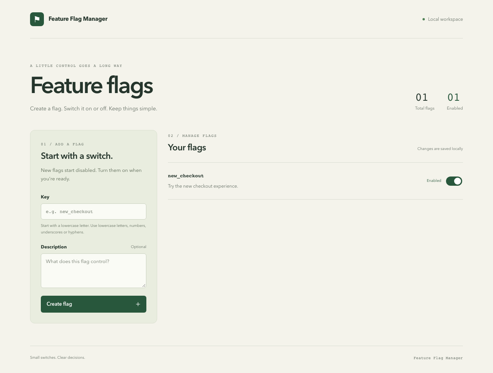
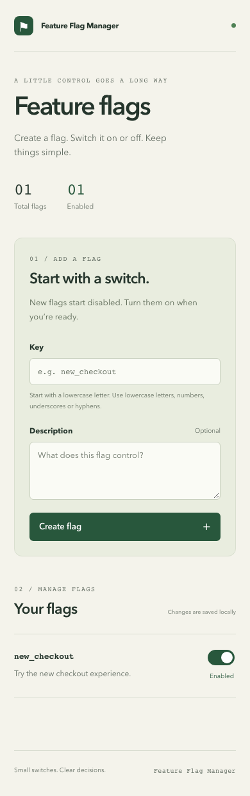

# Feature flags

Open http://127.0.0.1:5173 after starting the app. No sign-in is needed.

## Create a flag

Enter a unique **Key**, add a **Description** if useful, then select **Create flag**. Keys start with a lowercase letter and can contain lowercase letters, numbers, underscores, and hyphens. New flags start disabled.

## Change its state

Select the switch beside a flag to enable or disable it. Wait for the change to finish. Flags keep their saved state when you reload or restart the backend.

## If something fails

The app shows an error when it cannot load or save. Retry loading, submit the form again, or try the switch again. A failed save keeps your input and the last confirmed state. If a key already exists, choose another key.

Flags are shared by everyone using this backend. There is no sign-in, renaming, or deletion in this version.

## On a phone

The same form and switches work on smaller screens.

